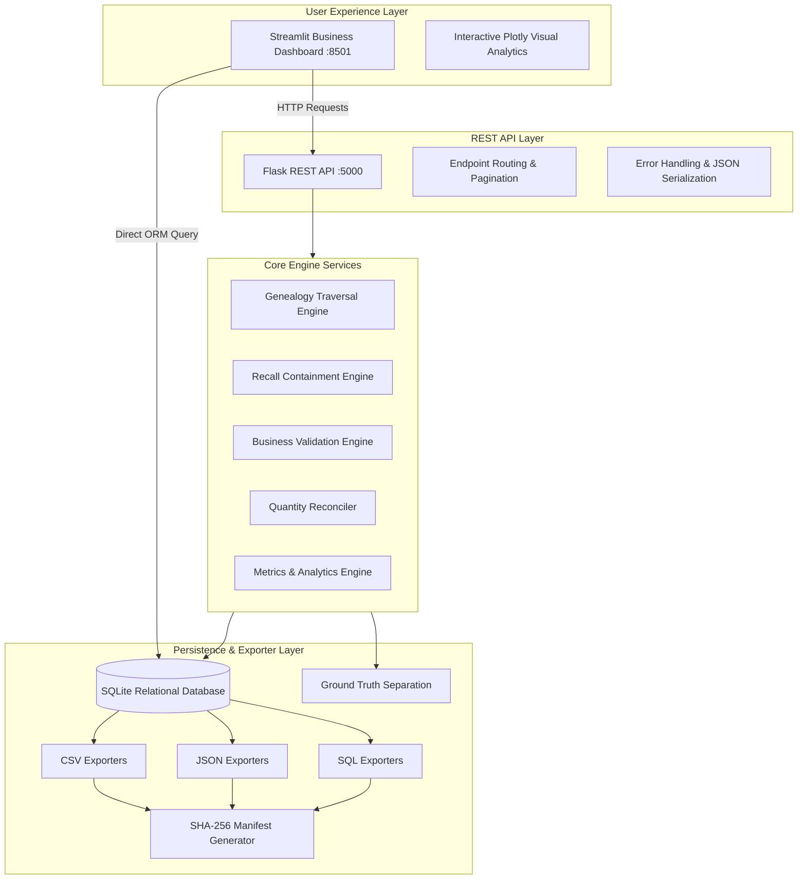
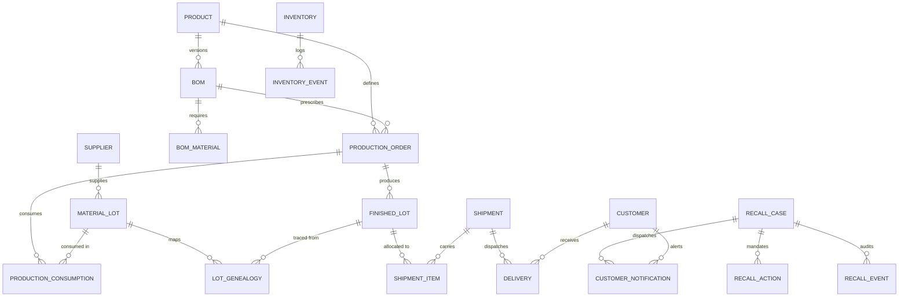
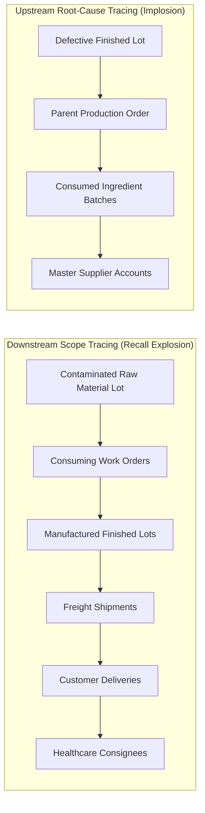
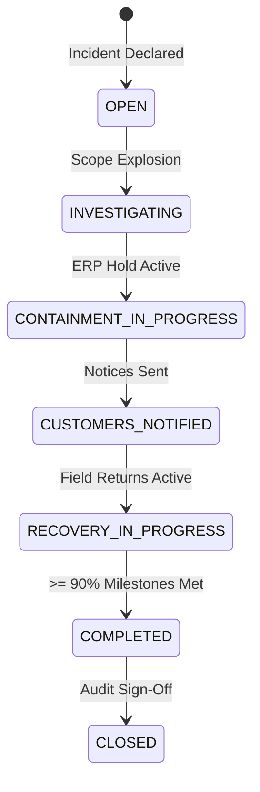
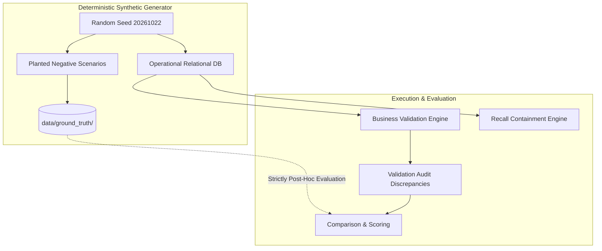

# LotTrace AI — System Architecture & Technical Design

## 1. Executive Architecture Summary

**LotTrace AI** is an enterprise-grade, locally deployable supply chain traceability and product recall intelligence platform. It models multi-echelon pharmaceutical and chemical manufacturing networks to trace contaminated materials through suppliers, manufacturing work orders, finished lots, warehouses, carrier freight shipments, and healthcare consignees.

---

## 2. Multi-Echelon Relational Entity Model (ERD)

The database schema is fully normalized in third normal form (3NF) across 20 tables with enforced foreign-key integrity (`PRAGMA foreign_keys=ON`) and indexing on all query dimensions:

---

## 3. Bidirectional Genealogy Traversal Algorithm

Genealogy traversal operates recursively in two fundamental directions:

### Algorithm Complexity & Loop Prevention
- **Cycle Prevention:** A visited set `visited_nodes: Set[str]` tracks traversed lots and orders, preventing infinite loops in cyclic dependencies or rework loops.
- **Complexity:** Time complexity is $O(V + E)$ where $V$ represents entities (lots, orders, shipments, customers) and $E$ represents edges (consumptions, outputs, deliveries). With indexed foreign keys in SQLite, downstream traversal across thousands of records executes in under 15 milliseconds.

---

## 4. Product Recall Lifecycle State Machine

Recalls strictly transition across validated lifecycle stages, logging every transition to `recall_events`:

### Idempotent Action Dispatch
The recall engine guarantees **idempotency**:
1. Checks for existing `RecallAction` of type `QUARANTINE_INVENTORY` before creating duplicate warehouse holds.
2. Deduplicates `CustomerNotification` records by `(recall_id, customer_id)`.
3. Ensures repeated executions update metrics without corrupting ledger event history.

---

## 5. Ground Truth & Anomaly Separation Design

- Ground truth records (`ground_truth.csv` and `ground_truth.json`) are generated in a completely isolated directory.
- The operational database, validation engine, and recall engine do **NOT** read ground truth labels during execution.
- This enforces zero data leakage, enabling true blind auditing and objective QA testing.
