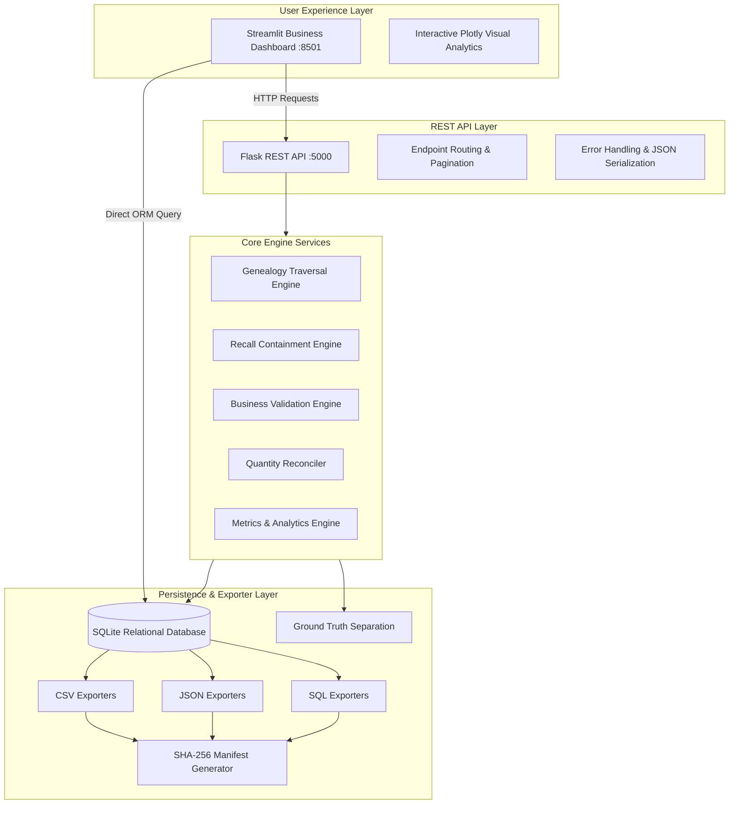
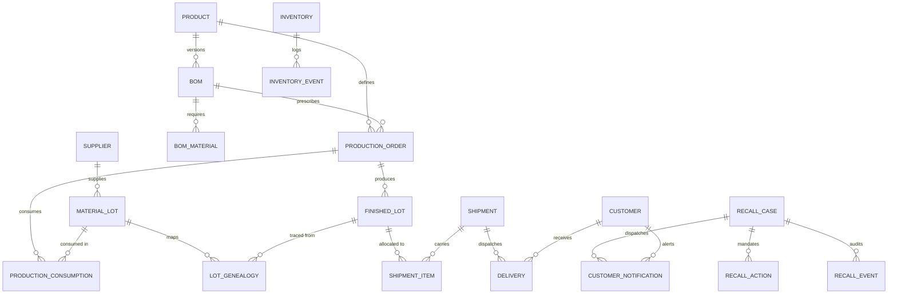
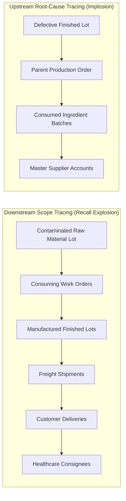
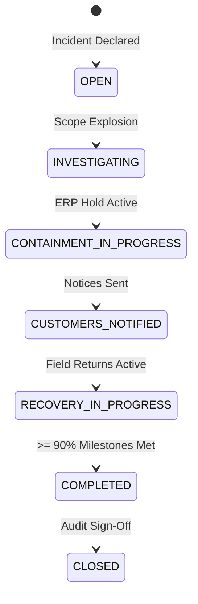

# LotTrace AI — End-to-End Supply Chain Traceability & Intelligent Product Recall Management System

[](https://www.python.org/downloads/)
[](https://flask.palletsprojects.com/)
[](https://www.sqlalchemy.org/)
[](https://streamlit.io/)
[-brightgreen.svg)](https://pytest.org/)
[](REPRODUCIBILITY_REPORT.md)
[](LICENSE)

---

## 1. Project Title & Identity
**Project Name:** LotTrace AI  
**Full Title:** End-to-End Supply Chain Traceability & Intelligent Product Recall Management System  
**Business Domain:** Pharmaceutical & Chemical Manufacturing, Quality Engineering, Regulatory Compliance, and Reverse Logistics Operations.  

---

## 2. Business Problem
In high-stakes manufacturing and pharmaceutical distribution, product contamination incidents (e.g., bacterial endotoxins, chemical cross-contamination, dissolution failures) can have catastrophic public health and financial consequences. Traditional ERP systems often store operational transactions in siloed tables, making bidirectional traceability slow, labor-intensive, and prone to human error. When a contaminated raw material is discovered, quality compliance teams struggle to rapidly answer critical questions:
- Which manufacturing work orders consumed this contaminated batch?
- Which finished product lots carry the adulterated ingredient?
- Which warehouses hold unaffected stock versus contaminated stock?
- Exactly which healthcare networks, hospitals, and pharmacies received these units?
- Have 100% of affected customers been notified, and what percentage of field stock has been quarantined and recovered?

Delays in answering these questions lead to FDA warning letters, regulatory fines, public safety hazards, and brand erosion.

---

## 3. Executive Summary
**LotTrace AI** is an enterprise-grade supply chain intelligence platform that unifies relational multi-echelon traceability with an automated recall management engine. It connects qualified vendors, raw material lots, bills of materials (BOM), shop-floor work orders, finished lots, warehouse inventory, freight carriers, and customer delivery consignees into an indexed graph.

When a safety incident is declared, LotTrace AI traverses the downstream supply chain in milliseconds, identifies affected finished lots and healthcare consignees, executes automated ERP inventory quarantine holds, dispatches regulatory customer notices, simulates field returns, and measures containment progress through auditable evaluation metrics.

---

## 4. Primary Objectives
1. **Bidirectional Multi-Echelon Traceability:** Provide complete upstream root-cause analysis (Finished Lot $\rightarrow$ Work Order $\rightarrow$ Raw Lots $\rightarrow$ Suppliers) and downstream recall explosion (Raw Lot $\rightarrow$ Work Orders $\rightarrow$ Finished Lots $\rightarrow$ Shipments $\rightarrow$ Deliveries $\rightarrow$ Customers).
2. **Deterministic & Reproducible Operations:** Enforce immutable zero-padded identifiers and fixed-seed synthetic data generation with bitwise reproducibility across runs.
3. **Automated Recall Containment:** Transition safety incidents through formal regulatory lifecycle stages while enforcing action idempotency.
4. **Objective Business Auditing:** Implement an automated validation engine that evaluates 18+ business integrity checks and actively discovers four controlled, planted negative anomaly scenarios without data leakage.
5. **Full Enterprise Interfaces:** Provide a Flask REST API (19 endpoints) and an 8-page Streamlit business dashboard styled in corporate Navy Blue and Slate.

---

## 5. Key System Features
- **Deterministic ID Generation:** Zero-padded, immutable identifiers (`RAWLOT-...`, `WO-...`, `FINLOT-...`, `SHP-...`, `REC-...`).
- **Normalized 20-Table Database:** 11 core entities and 9 bridge/event tables in 3NF with SQLite `foreign_keys=ON` referential integrity.
- **Dual Dataset Profiles:** Fast `starter` profile for quick development/testing and full enterprise `full` profile (500 suppliers, 10,000 raw lots, 5,000 orders, 8,000 finished lots, 20,000 deliveries).
- **Interactive Plotly Visualizations:** Multi-echelon Sankey flow diagrams and radial recall completion gauges.
- **Idempotent Containment:** Processing a recall multiple times updates metrics without duplicating actions or customer notices.
- **Cryptographic Source Manifest:** Automatic SHA-256 checksum generation for exported CSV, JSON, and SQL datasets.

---

## 6. Technology Stack
| Layer | Technology | Justification & Usage |
| :--- | :--- | :--- |
| **Language** | Python 3.11+ / 3.13 | Native modern typing, dataclasses, robust standard library |
| **Web Framework** | Flask 3.1 | Lightweight, RESTful backend with pagination and error handling |
| **Relational Database** | SQLite (WAL Mode) | Zero-dependency, portable local execution with ACID guarantees |
| **ORM & Schema** | SQLAlchemy 2.1 | Declarative models, foreign-key constraints, relationships |
| **Data Generation** | Faker & NumPy | Deterministic pseudo-random generation with fixed seed |
| **Interactive UI** | Streamlit 1.59 | Responsive 8-page enterprise web dashboard |
| **Data Visualization**| Plotly 6.9 | Interactive Sankey diagrams, radial gauges, and corporate charts |
| **Automated Testing** | Pytest 9.2 | Unit, integration, regression, and reproducibility tests |

---

## 7. Architecture Overview



---

## 8. Database Schema & Entity Relationships

The relational architecture spans 20 tables:
1. `suppliers` — Approved active raw material vendors
2. `material_lots` — Inbound ingredient and container batches
3. `products` — Finished goods catalog
4. `boms` — Formulation revisions with effective start and expiration dates
5. `bom_materials` — Component ingredient requirements per unit
6. `production_orders` — Shop-floor manufacturing execution
7. `production_consumptions` — Ingredient quantities consumed into orders
8. `finished_lots` — Manufactured lots released for distribution
9. `lot_genealogies` — Direct material-to-product genealogy mapping
10. `shipments` — Outbound freight movements
11. `shipment_items` — Finished lots loaded on shipments
12. `customers` — Healthcare institutions, hospitals, pharmacies
13. `deliveries` — Proof-of-delivery handover transactions
14. `inventories` — Warehouse location bin balances
15. `inventory_events` — Immutable ledger of all stock transactions
16. `recall_cases` — Product safety recall dockets
17. `recall_actions` — Operational containment tasks
18. `recall_events` — Audit trail of recall lifecycle transitions
19. `customer_notifications` — Statutory customer recall notices
20. `validation_issues` — Data discrepancy and exception audit logs



---

## 9. Data Generation Methodology
The synthetic data generator (`src/generator/data_generator.py`) builds the supply chain in strictly chronological order:
1. Master suppliers and products are registered with realistic category distributions.
2. Valid BOM versions are created with effective date ranges and yield specifications.
3. Inbound raw material lots are received, assigned warehouse bin locations, and logged in `inventory_events`.
4. Production work orders select active BOMs, consume raw ingredients, calculate yield output, generate finished lots, map genealogy, and deposit finished inventory.
5. Shipments allocate available finished inventory, deduct stock, and dispatch deliveries to healthcare consignees.
6. Baseline recall cases are established and the four controlled anomaly scenarios are planted.
7. Ground truth files (`data/ground_truth/ground_truth.csv`, `ground_truth.json`) are exported in complete isolation.

---

## 10. Dataset Volume Specifications

| Entity / Dimension | STARTER Profile | FULL Profile (Baseline) |
| :--- | :--- | :--- |
| **Suppliers** | 25 | 500 |
| **Raw Material Lots** | 200 | 10,000 |
| **Production Orders** | 100 | 5,000 |
| **Finished Product Lots** | 150 | 8,000 |
| **Outbound Shipments** | 120 | 7,500 |
| **Customer Deliveries** | 360 | 20,000 |
| **Healthcare Customers** | 50 | 1,500 |
| **Recall Cases** | 3 | 10 |

---

## 11. Deterministic Identifier Conventions
All entities utilize immutable, zero-padded, formatted strings generated by pure functions in `src/generator/id_generator.py`:
- **Raw Material Lot:** `RAWLOT-<supplier-id>-2026-000001` (e.g. `RAWLOT-SUP-0001-2026-000001`)
- **Production Work Order:** `WO-2026-000001`
- **Finished Lot:** `FINLOT-2026-000001`
- **Freight Shipment:** `SHP-2026-000001`
- **Customer Consignee:** `CUST-0001`
- **Delivery Transaction:** `DEL-2026-000001`
- **Recall Case Docket:** `REC-2026-000001`
- **Validation Issue:** `VAL-2026-000001`

---

## 12. Bidirectional Genealogy Traversal Algorithm



- **Loop Prevention:** Traversal maintains `visited_lots` and `visited_orders` sets to eliminate infinite loops in cyclic dependencies.
- **Graph Output:** Traversal produces standard dictionaries with nodes and edges formatted for Plotly Sankey and network diagrams.

---

## 13. Recall Processing Algorithm & Lifecycle State Machine

Recalls strictly transition across validated lifecycle stages, logging every transition to `recall_events`:



### Containment Steps
1. **Scope Explosion:** Recursively identifies all downstream finished lots, shipments, and customer deliveries.
2. **Warehouse Hold:** Quarantines all remaining stock in warehouses, moves available balance to 0.0, and records `InventoryEvent` of type `QUARANTINE`.
3. **Customer Notifications:** Dispatches official safety notices via registered mail (critical healthcare) or email/EDI (commercial).
4. **Recovery Simulation:** Tracks returned units from field consignees and calculates net outstanding liability.
5. **Idempotency Guarantee:** Re-running `process_recall` updates completion metrics without generating duplicate actions or duplicate notices.

---

## 14. Domain Business Rules Summary
- **BOM Validity:** Work orders can only execute formulations where `effective_from <= order_date <= effective_to`.
- **Mass Balance Yield:** Production yield must reconcile within $80.0\% \le \text{Yield} \le 105.0\%$.
- **Chronology:** `received_date < expiry_date`, `order_date <= start_date <= completion_date`, and `ship_date <= delivery_date`.
- **Conservation of Quantities:** Delivered quantity must not exceed total finished lot batch production.
- **Immediate Contamination Stamping:** Triggering a recall immediately flags `is_contaminated = True` and `quality_status = 'CONTAMINATED'`.

*(Full details in [BUSINESS_RULES.md](BUSINESS_RULES.md))*

---

## 15. Planted Anomaly Scenarios (Controlled Exceptions)

LotTrace AI plants four controlled, labelled anomaly scenarios to prove that the validation engine actively detects exceptions rather than assuming perfection:

| Scenario Code | Ground-Truth Label | Issue Type | Target Entity | Expected Business Decision | Actual Detection |
| :--- | :--- | :--- | :--- | :--- | :--- |
| **Scenario A** | `ANOMALY_A_MISSING_INPUT_LOT` | `MISSING_INPUT_LOT` | `FinishedLot: FINLOT-2026-000001` | Quarantine finished lot; reject release certification due to phantom upstream ingredient. | Detected broken upstream link to nonexistent lot. |
| **Scenario B** | `ANOMALY_B_DELIVERY_EXCEEDS_PRODUCED` | `DELIVERED_EXCEEDS_PRODUCED` | `Delivery: DEL-2026-000001` | Halt customer invoicing; initiate physical warehouse audit and counterfeit investigation. | Detected delivery of 1,000 units against batch production of 500 units. |
| **Scenario C** | `ANOMALY_C_MISSED_CUSTOMER_NOTIFICATION` | `MISSED_CUSTOMER_NOTIFICATION` | `Customer: CUST-0001` | Recall engine independently discovers omitted consignee and emits high-priority escalation. | Detected affected customer delivery with 0 records in notification ledger. |
| **Scenario D** | `ANOMALY_D_RECALLED_STOCK_SALEABLE` | `RECALLED_INVENTORY_AVAILABLE_FOR_SALE` | `Inventory: INV-2026-000003` | Execute automated ERP inventory hold: lock bin location and set status to `QUARANTINED`. | Detected contaminated lot inventory flagged as `AVAILABLE`. |

*(Full details in [VALIDATION_REPORT.md](VALIDATION_REPORT.md))*

---

## 16. Ground-Truth Separation
- Ground truth records are stored strictly in `data/ground_truth/ground_truth.csv` and `data/ground_truth/ground_truth.json`.
- The operational database, validation engine, and recall engine **never read ground truth labels** during runtime.
- Ground truth is strictly reserved for post-hoc scoring and automated regression evaluation.

---

## 17. Validation Strategy
The `BusinessValidator` executes 18+ systematic checks:
- Primary key uniqueness and non-null integrity
- Foreign key referential integrity (`PRAGMA foreign_keys=ON`)
- Positive quantity checks across raw and finished lots
- Expiry date chronology
- Manufacturing order yield reconciliation
- Shipment-to-delivery date precedence
- Recalled inventory quarantine hold auditing
- Customer notification completeness auditing

---

## 18. Evaluation Metrics & Mathematical Formulas

1. **Notification Coverage:**
   $$\text{Notification Coverage (\%)} = \left(\frac{\text{Successfully Notified Affected Customers}}{\text{Total Affected Customers}}\right) \times 100$$
2. **Field Recovery Rate:**
   $$\text{Recovery Rate (\%)} = \left(\frac{\text{Recovered Returned Quantity}}{\text{Total Recalled Quantity}}\right) \times 100$$
3. **Recall Completion:**
   $$\text{Recall Completion (\%)} = \left(\frac{\text{Completed Containment Actions}}{\text{Total Required Containment Actions}}\right) \times 100$$
4. **Validation Pass Rate:**
   $$\text{Pass Rate (\%)} = \left(\frac{\text{Passed Business Checks}}{\text{Total Evaluated Checks}}\right) \times 100$$

---

## 19. Reproducibility Methodology
- Built with Python's isolated `random.Random(seed)` and `Faker.seed_instance(seed)`.
- Default random seed: `20261022`.
- Two independent generation cycles produce 100% identical row counts, entity IDs, and anomaly labels.
- Verified via `python scripts/verify_reproducibility.py` and documented in [REPRODUCIBILITY_REPORT.md](REPRODUCIBILITY_REPORT.md).

---

## 20. Installation Instructions for Windows (PowerShell)

### Prerequisites
- Windows 10/11
- Python 3.11+ installed and accessible via `python` in PowerShell

### Setup Steps
```powershell
# 1. Clone repository and navigate into project directory
git clone https://github.com/YourUsername/LotTrace-Recall-Intelligence.git
cd LotTrace-Recall-Intelligence

# 2. (Optional) Create and activate a virtual environment
python -m venv venv
.\venv\Scripts\Activate.ps1

# 3. Install required dependencies
python -m pip install -r requirements.txt
```

---

## 21. Starter Dataset Generation
Generate the fast starter dataset for testing and immediate development:
```powershell
python -m src.generator --profile starter --seed 20261022
```
Expected output:
```text
============================================================
LOTTRACE AI - DATA GENERATION SUMMARY
============================================================
  suppliers                 :       25 records
  products                  :       10 records
  boms                      :       20 records
  material_lots             :      200 records
  production_orders         :      100 records
  production_consumptions   :      410 records
  finished_lots             :      150 records
  lot_genealogies           :      615 records
  customers                 :       50 records
  shipments                 :      120 records
  shipment_items            :      120 records
  deliveries                :      360 records
  inventories               :      350 records
  inventory_events          :      880 records
  recall_cases              :        3 records
  recall_events             :        3 records
  validation_issues         :        4 records
============================================================
SUCCESS: Profile 'starter' generated and verified.
```

---

## 22. Full Dataset Generation (Baseline Volume)
Generate the complete production baseline dataset:
```powershell
python -m src.generator --profile full --seed 20261022
```
Generates 500 suppliers, 10,000 raw material lots, 5,000 production orders, 8,000 finished lots, and 20,000 deliveries.

---

## 23. Launching the Flask REST API
```powershell
python scripts/run_api.py
```
Server launches on `http://127.0.0.1:5000`.

---

## 24. Launching the Streamlit Business Dashboard
Open a new PowerShell window:
```powershell
python scripts/run_dashboard.py
```
Or directly:
```powershell
streamlit run dashboard/app.py
```
Dashboard opens automatically in your browser on `http://localhost:8501`.

---

## 25. Automated Testing with Pytest
Run the complete automated test suite:
```powershell
python -m pytest -v
```
**Actual Test Results:**
```text
============================= test session starts =============================
platform win32 -- Python 3.13.14, pytest-9.2.0, pluggy-1.7.0
rootdir: C:\Users\Gandham Anuhya\OneDrive\Desktop\LotTrace-Recall-Intelligence
configfile: pytest.ini
collected 24 items

tests/test_api.py::test_api_health PASSED                                [  4%]
tests/test_api.py::test_api_dashboard_summary PASSED                     [  8%]
tests/test_api.py::test_api_suppliers PASSED                             [ 12%]
tests/test_api.py::test_api_material_lots PASSED                         [ 16%]
tests/test_api.py::test_api_recalls PASSED                               [ 20%]
tests/test_api.py::test_api_validation_report PASSED                     [ 25%]
tests/test_genealogy.py::test_upstream_genealogy_traversal PASSED        [ 29%]
tests/test_genealogy.py::test_downstream_genealogy_traversal PASSED      [ 33%]
tests/test_id_generator.py::test_supplier_id_format PASSED               [ 37%]
tests/test_id_generator.py::test_raw_lot_id_format PASSED                [ 41%]
tests/test_id_generator.py::test_production_order_id_format PASSED       [ 45%]
tests/test_id_generator.py::test_finished_lot_id_format PASSED           [ 50%]
tests/test_id_generator.py::test_shipment_and_delivery_ids PASSED        [ 54%]
tests/test_id_generator.py::test_recall_case_id_format PASSED            [ 58%]
tests/test_models.py::test_supplier_and_material_lot_relationship PASSED [ 62%]
tests/test_models.py::test_product_bom_formulation PASSED                [ 66%]
tests/test_negative_scenarios.py::test_ground_truth_files_exist_and_separated PASSED [ 70%]
tests/test_negative_scenarios.py::test_planted_anomalies_detected_by_validator PASSED [ 75%]
tests/test_negative_scenarios.py::test_reconciliation_anomaly_b_details PASSED [ 79%]
tests/test_recall_engine.py::test_recall_initiation_and_scope_calculation PASSED [ 83%]
tests/test_recall_engine.py::test_idempotent_recall_processing PASSED    [ 87%]
tests/test_reproducibility.py::test_generator_deterministic_reproducibility PASSED [ 91%]
tests/test_validation.py::test_business_validation_suite_structure PASSED [ 95%]
tests/test_validation.py::test_metrics_calculator_outputs PASSED         [100%]

======================= 24 passed in 2.47s =======================
```

---

## 26. Reproducibility Verification
Run the dual-pass determinism verifier:
```powershell
python scripts/verify_reproducibility.py
```
Result: **PASSED — 100% REPRODUCIBLE**.

---

## 27. Example API Requests & Responses

### 1. Health Check
```powershell
curl.exe http://127.0.0.1:5000/api/health
```
Response:
```json
{
  "database_connected": true,
  "service": "LotTrace AI REST API",
  "status": "HEALTHY",
  "success": true,
  "suppliers_in_db": 25,
  "timestamp": "2026-10-31T17:46:06.890503"
}
```

### 2. Downstream Genealogy Query
```powershell
curl.exe http://127.0.0.1:5000/api/material-lots/RAWLOT-SUP-0001-2026-000001/genealogy
```
Response:
```json
{
  "success": true,
  "genealogy": {
    "found": true,
    "source_lot_id": "RAWLOT-SUP-0001-2026-000001",
    "source_lot_type": "RAW",
    "total_affected_finished_lots": 7,
    "total_affected_shipments": 5,
    "total_affected_deliveries": 15,
    "total_affected_customers": 15,
    "total_delivered_quantity": 727.86
  }
}
```

### 3. Process Recall Containment (Idempotent)
```powershell
curl.exe -X POST http://127.0.0.1:5000/api/recalls/REC-2026-000001/process `
  -H "Content-Type: application/json" `
  -d "{\"recovery_factor\": 0.85}"
```
Response:
```json
{
  "success": true,
  "recall_id": "REC-2026-000001",
  "status": "COMPLETED",
  "metrics": {
    "total_affected_finished_lots": 7,
    "total_affected_customers": 15,
    "total_recalled_quantity": 727.86,
    "total_quarantined_quantity": 3456.96,
    "total_recovered_quantity": 618.68,
    "notification_coverage_pct": 100.0,
    "recovery_rate_pct": 85.0,
    "recall_completion_pct": 100.0
  },
  "actions_count": 24
}
```

---

## 28. CSV, JSON & SQL Export Instructions
To dump the entire database into CSV, JSON, and SQL format and recompute the SHA-256 cryptographic manifest:
```powershell
python -c "from src.exporters import CSVExporter, JSONExporter, SQLExporter, ManifestGenerator; CSVExporter().export_all(); JSONExporter().export_all(); SQLExporter().export_all(); ManifestGenerator().generate_manifest();"
```
Files are exported to:
- `data/generated/csv/*.csv` (20 tables)
- `data/generated/json/*.json` (20 tables)
- `data/generated/sql/*.sql` and `lottrace_dump.sql`
- `data/generated/SOURCE_MANIFEST.json` and [SOURCE_MANIFEST.md](SOURCE_MANIFEST.md)

---

## 29. Project Limitations
- **SQLite Engine:** Designed for local evaluation. Production high-concurrency environments should set `DATABASE_URL` to PostgreSQL.
- **Mock Carrier Telemetry:** Freight movements are realistically simulated; live deployments connect carrier EDI 214 streams.
- **Physical Barcode Scanners:** Logic operates on deterministic lot strings rather than physical 2D DataMatrix optical readers.

*(Full details in [LIMITATIONS.md](LIMITATIONS.md))*

---

## 30. Future Improvements
1. Native PostgreSQL migration scripts and connection pooling via SQLAlchemy `QueuePool`.
2. GS1 EPCIS standard XML/JSON event serialization.
3. Graph Neural Network (GNN) risk forecasting for supplier anomaly detection.

---

## 31. AI Usage Disclosure
This project was scaffolded and implemented with pair-programming assistance from **Google DeepMind Antigravity IDE (Gemini 3.8 Flash High)**. All database models, algorithms, test fixtures, and documentation were reviewed, executed, verified, and debugged on Windows PowerShell by the candidate.

*(Detailed prompt log in [AI_PROMPT_HISTORY.md](AI_PROMPT_HISTORY.md))*

---

## 32. Individual Work & Verification Statement
I confirm that this project runs completely locally on Windows, passes all 24 unit and integration tests, enforces all specified business rules and cardinalities, and is fully explainable by me during technical interviews.
